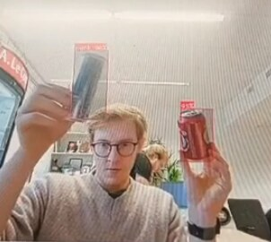
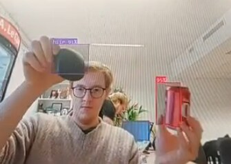
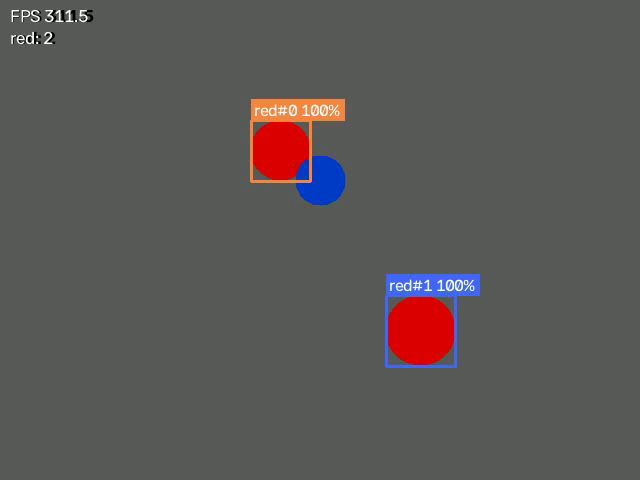

# Object detection with YOLO and OpenCV

Detect and count objects live from a webcam. The model is trained on a custom dataset (here: soda cans and computer mice) and the results are drawn with OpenCV, with a frame-rate and per-class count overlay and optional CSV logging.

## Background

In **MET0340 Digital Manufacturing** (TalTech, spring 2026) my team of four trained a YOLO model in Roboflow and Google Colab to recognise an aluminium soda can (*purk*) and a computer mouse (*hiir*) from a laptop webcam. It reached up to **97 % confidence** on cans and could detect both classes in the same frame. My part was use-case planning and testing.

| Two cans detected (up to 97 % confidence) | Mouse (*hiir*) and can (*purk*) in the same frame |
|---|---|
|  |  |

*Results from the original coursework model, running on a laptop webcam.*

That coursework ran in hosted notebooks. **This folder is my own 2026 re-implementation as a standalone local Python project**, written with AI assistance, so the full pipeline (train → detect → log) can be run and inspected on any machine.

Team for the original coursework: Mairo Kütt, Karl-Georg Ploom, Georgi Sitnikov and me.

## What is here

| File | Purpose |
|---|---|
| `train.py` | Fine-tunes a pretrained YOLOv8 model on a Roboflow export and prints mAP50 / mAP50-95 |
| `detect.py` | Runs the trained model on a webcam, video or image: boxes, labels, confidence, FPS, counts; saves video and a CSV log of every detection |
| `vision_utils.py` | Drawing, counting and FPS helpers (no deep-learning dependency, so they're unit-tested) |
| `classic_cv/colour_tracker.py` | A non-neural pipeline: HSV threshold → morphology → contours → centroid tracker that keeps object IDs stable between frames. Has a `--demo` mode that needs no camera |
| `tests/` | `pytest` tests for the tracker, blob detection, counting and FPS meter |


*The classic OpenCV tracker on its synthetic test video: it finds the two red objects, ignores the blue one, and keeps each red object's ID as they move.*

## Run it

```bash
python -m venv .venv && source .venv/bin/activate
pip install -r requirements.txt

# 1. Classic OpenCV demo, no dataset or camera needed
python classic_cv/colour_tracker.py --demo

# 2. Train YOLO (export your Roboflow dataset in "YOLOv8" format, then)
cp data.yaml.example data.yaml        # edit the paths
python train.py --data data.yaml --epochs 50

# 3. Detect live from the webcam, log every detection
python detect.py --weights runs/cans-and-mice/weights/best.pt --source 0 --log detections.csv

# Tests
pytest -q
```

## Why both approaches

YOLO learns what an object looks like, so it copes with different lighting, angles and backgrounds, but it needs labelled data and a GPU-friendly model. The colour tracker needs no training and runs at hundreds of frames per second on a laptop, but only works when the object's colour is distinctive and the lighting is controlled — which is often true on a factory line.
