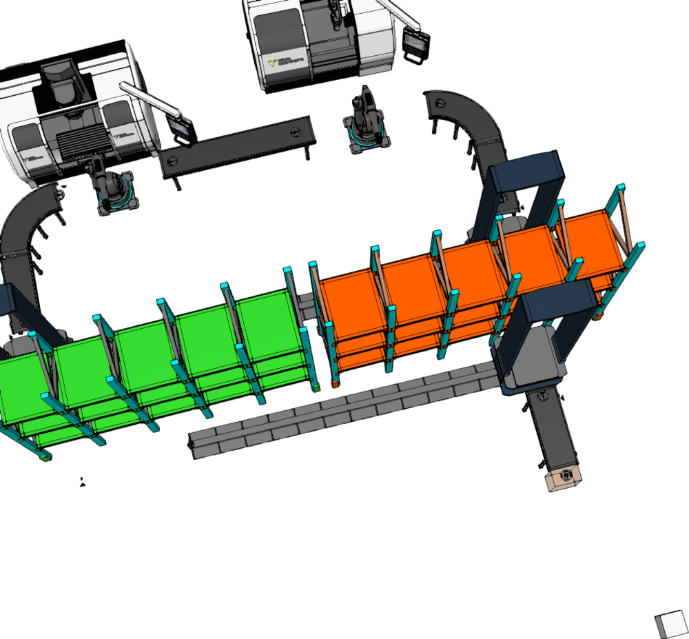

# Robot-tended machining cell: Visual Components digital twin

**Course:** MET0340 Digital Manufacturing (TalTech, spring 2026) · **Tool:** Visual Components 4.10 · Built with a classmate during the course

A 3D layout of a small automated production cell, built to simulate material flow before anything is installed on a real shop floor.

What is in the cell:
- **Two CNC machining centres**, each loaded and unloaded by its own **articulated robot**
- **Belt conveyors** with curved sections that carry parts between the machines
- **Two gantry portals** that move parts in and out of storage
- **Two multi-level storage racks** for raw parts and finished parts, plus a roller conveyor

## Why digital twins

Building the cell virtually first shows bottlenecks, reach problems and collisions in the planning stage, while changes are still cheap. This was my favourite part of the course, and it is the same idea behind the simulation-first approach I use in robotics (RobotStudio, MuJoCo, Gazebo).

## Open the model

[`robot_cell_layout.vcmx`](robot_cell_layout.vcmx) opens in Visual Components 4.10 or later.
