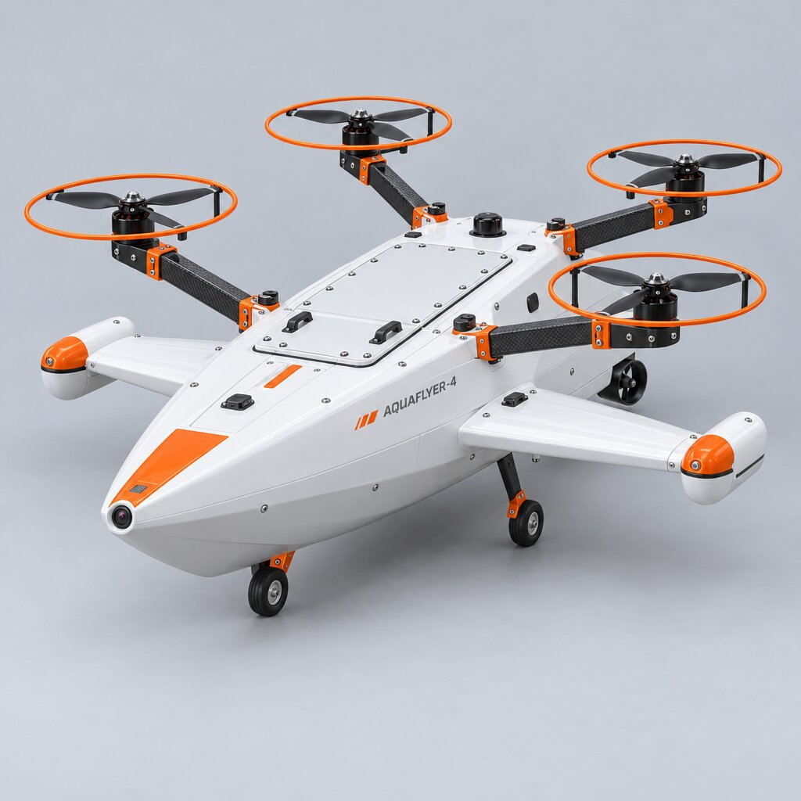
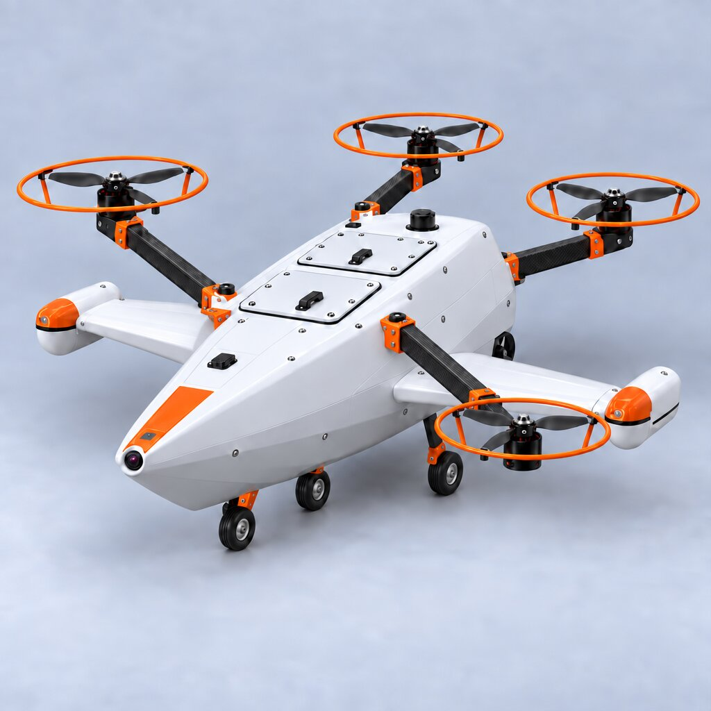

# Documents: proposals, concepts and lab reports

## Proposals and concept studies

Independent proposals I wrote outside my coursework. AI tools helped with research and editing; the ideas, direction and final decisions are mine.

| Document | Date | Summary |
|---|---|---|
| [Estonia Integrated Green Hydrogen Energy System (EIGHES)](proposals/EIGHES_Estonia_Green_Hydrogen_Proposal.pdf) | Mar 2026 · 25 pp | A national framework for producing, storing and exporting solar-powered green hydrogen in Estonia, aligned with Estonia's ENMAK 2035 energy plan and the EU REPowerEU programme. Also translated into Estonian. |
| [Lunar Settlement Vision: Autonomous Factory-First Approach](proposals/Lunar_Settlement_Autonomous_Factory_First.pdf) | Jan 2026 · 12 pp | A phased concept for building lunar infrastructure with autonomous robots and local resources before people arrive. |
| [Global Solar Energy Project Proposal and Thesis Plan](proposals/Global_Solar_Energy_Project_Proposal.pdf) | Sep 2025 · 9 pp | Small pilot solar installations in Botswana, Estonia and New Mexico to compare panel efficiency and economics across markets. |
| [Proposal for a Pan-African Economic Enforcement Alliance](proposals/Pan_African_Economic_Enforcement_Alliance.pdf) | Aug 2025 · 4 pp | A policy essay written during my exchange at the Botswana International University of Science and Technology (BIUST) on fair pricing for African exports. |

## Concepts: Icarus / AquaFlyer amphibious drone

A small, 3D-printable vehicle meant to **fly, float and drive**. I iterate the shape with AI-generated concept renders (Meshy AI) before modelling it in Fusion 360.

| 3-wheel layout with dual hatches | Flying-boat concept | Clean quad layout |
|---|---|---|
|  |  |  |

*Concept renders, not CAD. The project now has its own page: [personal-projects/aquaflyer](../personal-projects/aquaflyer/).*

## Coursework reports

Robotics and mechanical reports that have their own project page are linked there too.

| Report | Course | Notes |
|---|---|---|
| [Lab 1: Mitsubishi RV-2AJ pick-and-place](coursework-reports/ATR0030_Lab1_Mitsubishi_RV-2AJ.pdf) | ATR0030 Robotics, 2026 | [project page](../industrial-robotics/mitsubishi-melfa-basic/) |
| [Lab 2: ABB RobotStudio virtual station](coursework-reports/ATR0030_Lab2_ABB_RobotStudio.pdf) | ATR0030 Robotics, 2026 | [project page](../industrial-robotics/abb-robotstudio-rapid/) |
| [Lab 3: ABB IRB 1600, real robot](coursework-reports/ATR0030_Lab3_ABB_IRB1600_Real_Robot.pdf) | ATR0030 Robotics, 2026 | [project page](../industrial-robotics/abb-robotstudio-rapid/) |
| [Strength analysis of a bar structure](coursework-reports/MES0220_HW1_Bar_Structure_Strength.pdf) | MES0220 Machine Engineering, 2026 | Statics and stress check in S355 |
| [Section centroid and moments of inertia](coursework-reports/MES0220_HW2_Section_Properties.pdf) | MES0220 Machine Engineering, 2026 | Composite section properties |
| [Product analysis: a scholarship backpack](coursework-reports/MED0130_Product_Analysis_Backpack.pdf) | MED0130 Industrial Design Basics, 2026 | Context, use and quality analysis of a real product |
| [Solar PV lab report: power vs irradiance, maximum power point, temperature](coursework-reports/ENER511_Solar_PV_Lab_Report_BIUST.pdf) | ENER 511 Solar Energy Engineering, BIUST (Botswana exchange), 2025 | With lab partner Laone Matsetse |
| [Casting, forming and machining](coursework-reports/MTM0070_Casting_Forming_Machining.pdf) | MTM0070 Materials Engineering, 2025 | Forging design and process selection |
| [Trigonometric Wheel: rapid prototyping product project](../industrial-design/trigonometric-wheel/Trigonometric_Wheel_Report.pdf) | EMT0230 Rapid Prototyping, 2024 | [project page](../industrial-design/trigonometric-wheel/) |
