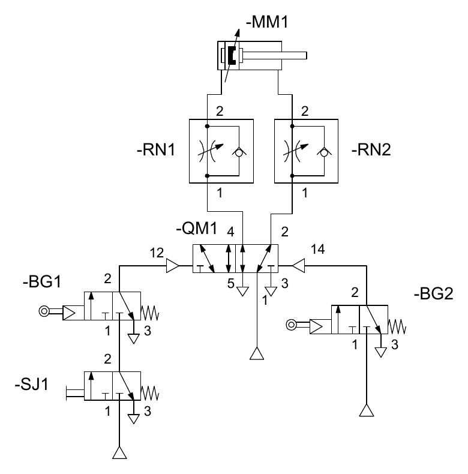
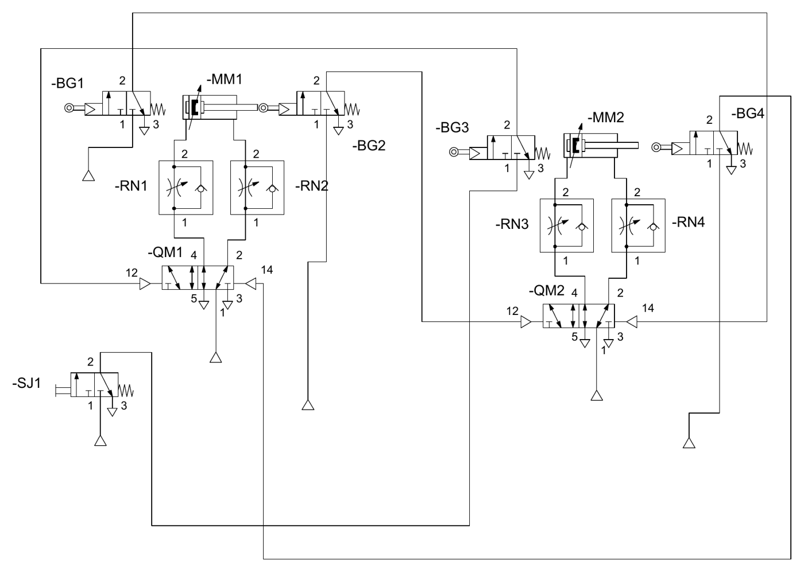
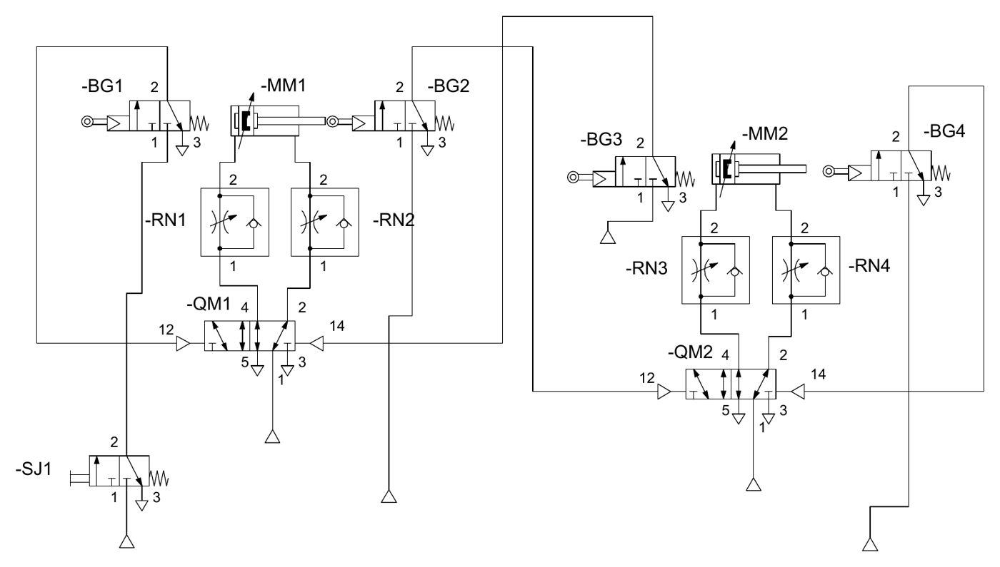

# Pneumatic control circuits (FluidSIM)

**Course:** MES0085 Hydraulics and Pneumatics (TalTech, autumn 2026) · **Tool:** Festo FluidSIM

I built all nine lab circuits in FluidSIM and tested them in simulation before the hands-on lab on 23 September 2026. They progress from basic valve control to automatic sequences:

| # | Circuit | What it teaches |
|---|---|---|
| 1 | Single-acting cylinder, 3/2 push-button valve | Basic valve and actuator symbols |
| 2 | + plain throttle | Speed control (affects one stroke only, because the spring drives the other) |
| 3 | + one-way flow control | Meter-out control of the extend stroke |
| 4 | Two anti-parallel one-way flow valves | Independent extend and retract speeds |
| 5 | Double-acting cylinder, bistable 5/2 valve | Latching (memory) control |
| 6 | + flow control on both lines | Independent speed in both directions |
| 7 | Sheet-metal bending device | First automatic sequence: limit switches and AND logic (start only when retracted, auto-return at full stroke) |
| 8 | Two-cylinder conveyor transfer | A+ B+ A− B− sequence, each limit switch triggers the next step |
| 9 | Two-cylinder drilling jig | Clamp → drill → retract → release sequence with interlocks |

| Ex. 7 – bending device | Ex. 8 – conveyor transfer | Ex. 9 – drilling jig |
|---|---|---|
|  |  |  |

- [`circuits/`](circuits/): the FluidSIM files (`.circ`), open in FluidSIM 6 or later
- [Write-up of all nine circuits (PDF)](Pneumatic_Circuits_Write-up.pdf). *The text was drafted with AI assistance from my circuits.*

The sequencing logic in exercises 7–9 is the same idea as a PLC step sequence: each step runs only when the previous one has been confirmed by a sensor.
