# Indoor cabinet grill: from user interviews to CAD and prototypes

**Course:** MED0130 Industrial Design Basics (TalTech, spring 2026) · **Team G:** Georg Berting, Jordan Brodie, Karl Johannes Randrüt, Marcus Karu · **Tools:** Miro (shared research board), SolidWorks, 3D printing

A semester-long design project following a full human-centred design process, from interviews with real grill users to a CAD model and two physical prototypes. I took part in the user interviews, helped build the SolidWorks CAD model together with my teammates, and kept the team organised and on schedule.

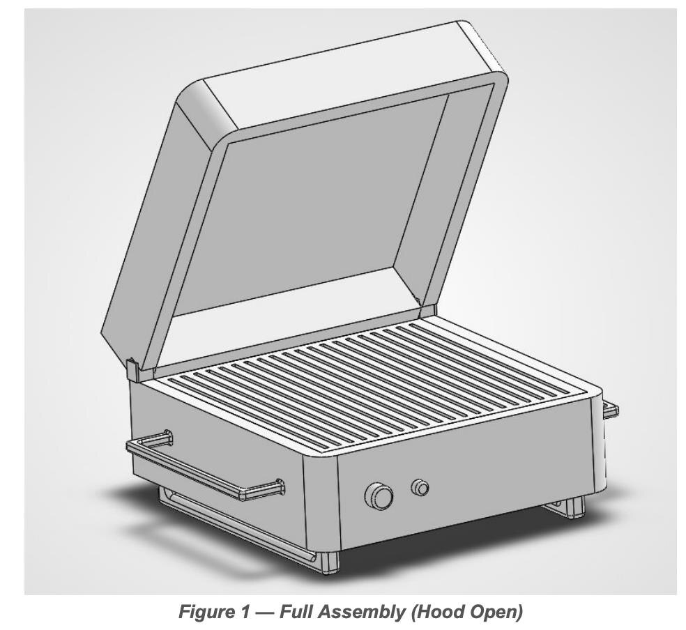

## The brief

Design a premium, low-effort grill for **urban apartment dwellers aged 25–45** who have little outdoor space, value convenience and still want real grilled flavour.

## 1. Research: interviews and insights

We interviewed grill owners about their habits, budgets and pain points and clustered the observations on a shared Miro board.

| Interview observations (positive / negative / surprising) | Clustered into insights |
|---|---|
| 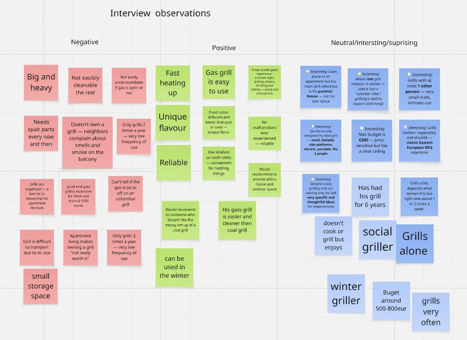 | 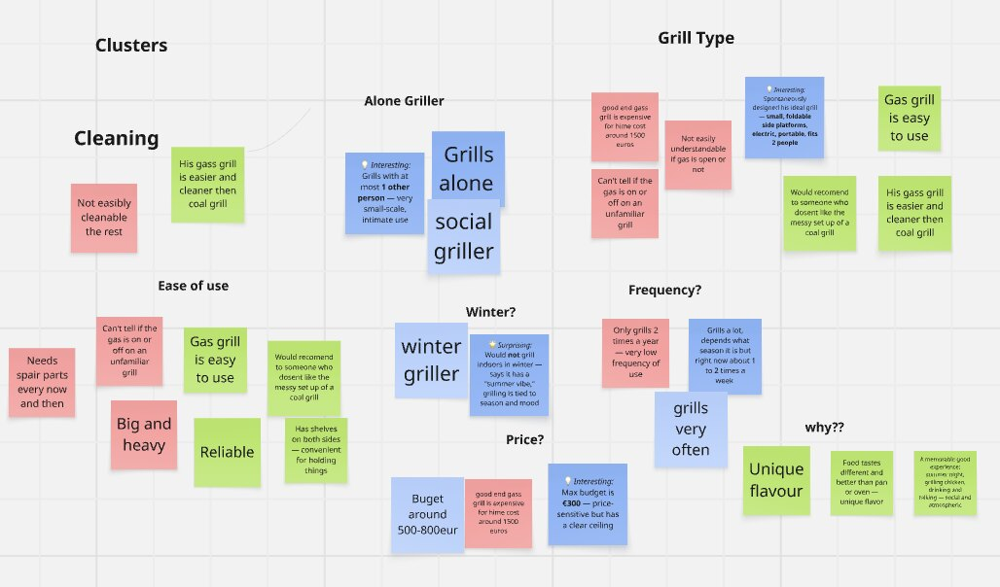 |

Key insights:
1. Frequent grillers grill 1–2 times a week **in season**, and **winter is a blocker** (grilling has a "summer vibe").
2. Grilled flavour is the reason people grill: it "tastes different and better than pan or oven".
3. Good gas grills cost about €1500, but the budget is €300–800.
4. **Apartments create barriers:** neighbours complain, there's smoke on the balcony, and it's "not worth it".
5. Users **can't tell if the gas is on or off**, and spare parts add cost.

We also analysed **typical** users (busy urban residents), **extreme** users (pitmasters) and **forced** users (apartment dwellers under strict rules).

## 2. Problem statements → "How might we…"

| Problem | How might we… |
|---|---|
| Size & storage | …help users feel confident storing their grill when living space is limited? |
| Cleaning | …reduce the effort users associate with cleaning? |
| Time | …help users enjoy grilled meals with limited time? |
| Usability | …reduce uncertainty with unfamiliar grill features (gas on/off)? |
| Maintenance | …make a grill with fewer parts that need replacing? |
| Indoor winter use | …bring grilling into the home without disrupting the living environment? |

## 3. Concepts and selection

Three concepts for the same user, scored against nine criteria. **Concept 1, a cabinet-stored grill top that replaces the gas stove top**, met the most criteria.

| Criterion | Concept 1 | Concept 2 | Concept 3 |
|---|:---:|:---:|:---:|
| Saves time | + | + | = |
| Easy to clean | + | = | = |
| Easy to understand | + | = | + |
| For apartment owners | + | + | + |
| Storage space | + | = | + |
| Easy to assemble | + | = | + |
| Can be used indoors | + | − | + |
| Portable | − | + | + |
| Realistic to prototype | + | − | = |

| Concept sketches | | Storyboard |
|---|---|---|
| 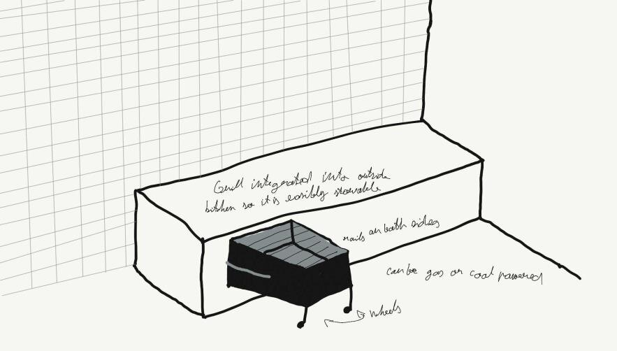 | 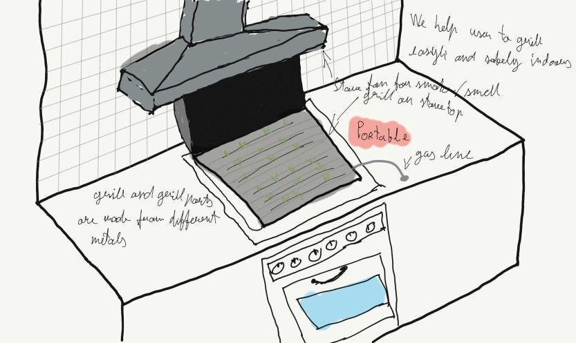 | 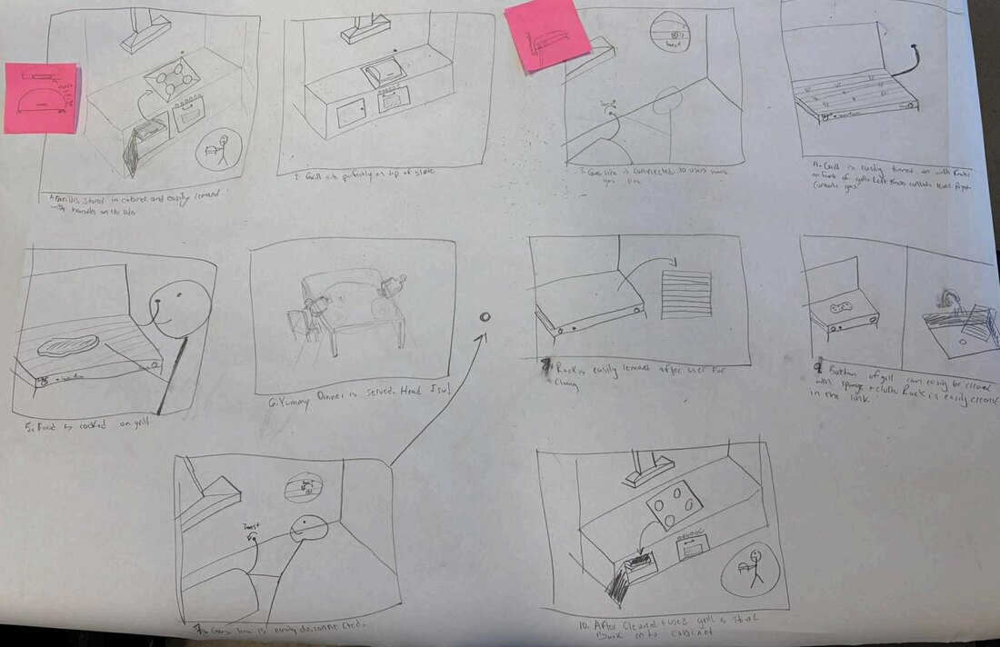 |

## 4. Design intent, colours, materials and finish (CMF)

"Professional kitchen tool": minimalist, industrial, durable.
- **Exterior:** brushed 304 stainless steel, which resists corrosion and fingerprints
- **Grate:** enamel-coated cast iron, which tolerates high heat and cleans fast
- **Gas connection:** brass quick-connect fitting
- **Interior:** porcelain enamel, non-porous and easy to clean
- **Controls:** left knob for flame intensity; right knob for gas on/off **with a safety lock**, which answers the "is the gas on?" problem
- **Cleaning:** removable inner tray, rounded internal corners, drip channel below the grate

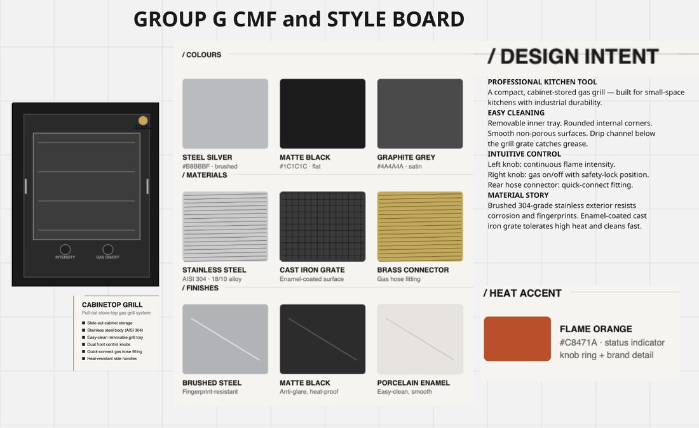

## 5. CAD

Modelled as a team (I worked on it with my teammates) as separate parts (body, hood, grill rack) from dimensioned sketches, then assembled.

| Base sketch (700 × 350 mm) | Grill rack sketch | Grill body | Hood | Grill rack |
|---|---|---|---|---|
| 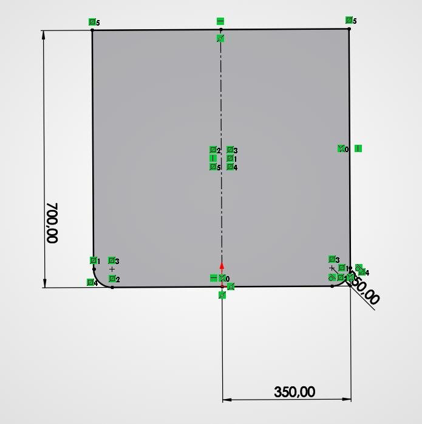 | 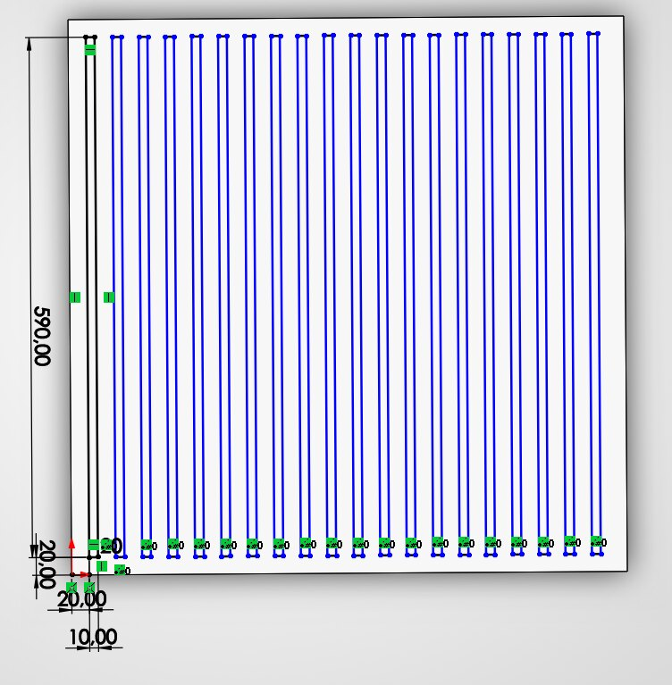 | 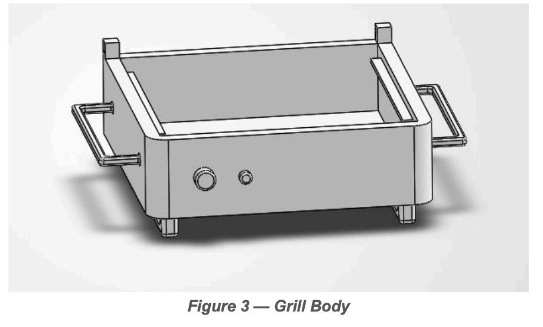 | 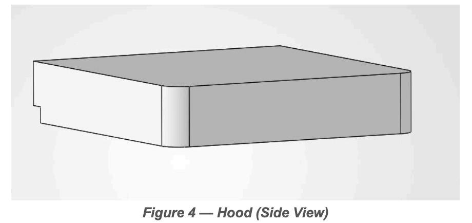 | 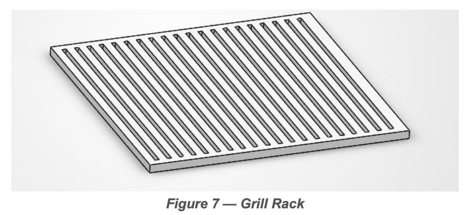 |

| Assembly, hood closed | Side view | Hood (STL, 700 × 750 × 150 mm) |
|---|---|---|
| 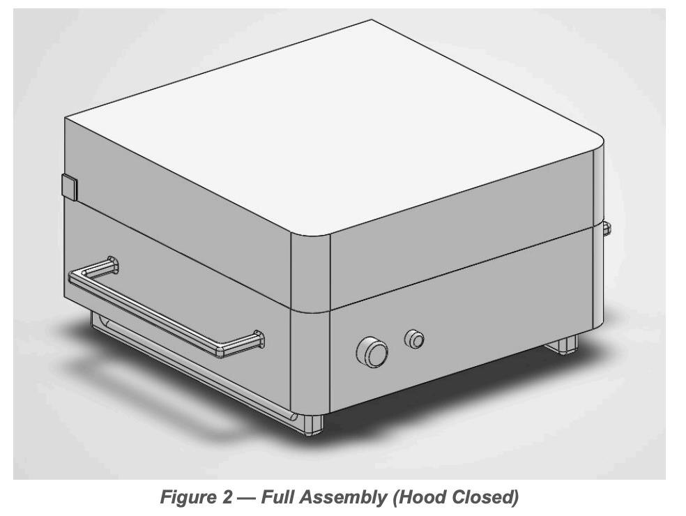 | 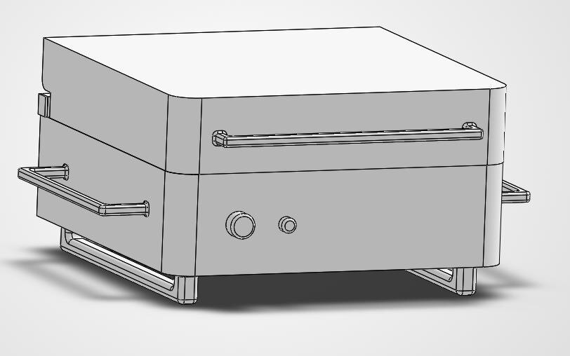 | 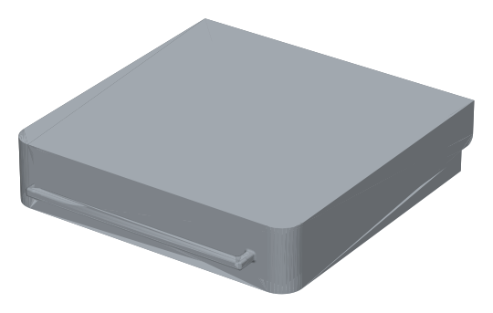 |

[`cad/Grill_Hood.stl`](cad/Grill_Hood.stl) is the hood part exported for printing (GitHub shows STL files in 3D).

## 6. Prototypes

Two physical prototypes were built to test form and proportion.

| Prototype 1 | | Prototype 2 | |
|---|---|---|---|
| 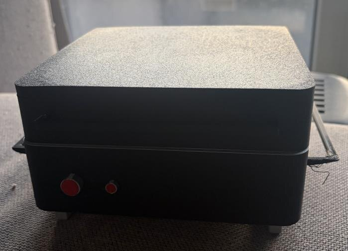 | 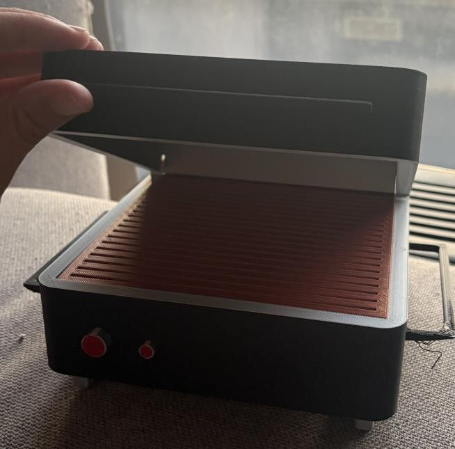 | 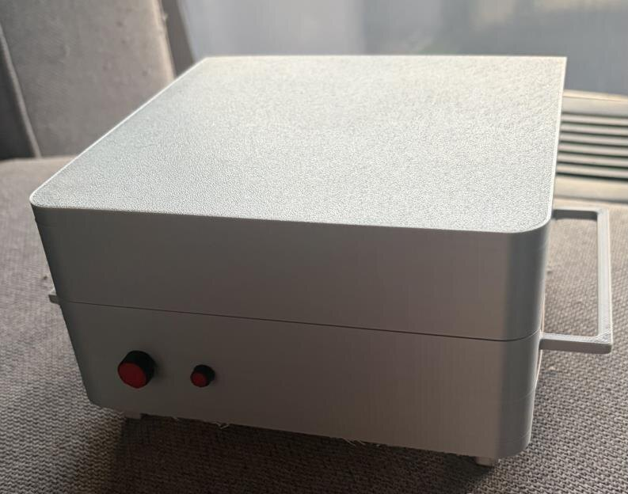 | 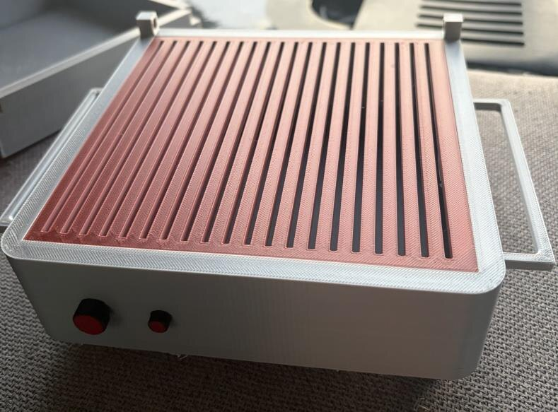 |

Full presentation: [Indoor_Grill_Group_Report.pdf](Indoor_Grill_Group_Report.pdf)

## What I took from it

Design decisions can be made systematically instead of by taste: interviews → clustered insights → problem statements → criteria matrix. It is the same requirements-driven thinking I use in systems engineering.
