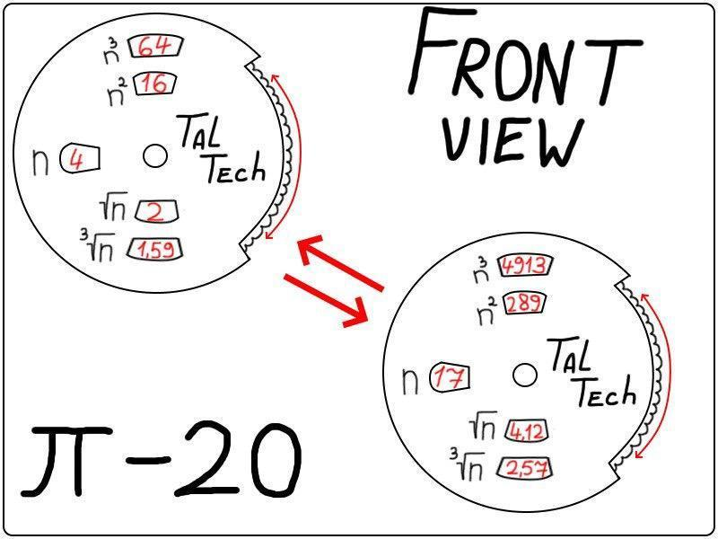
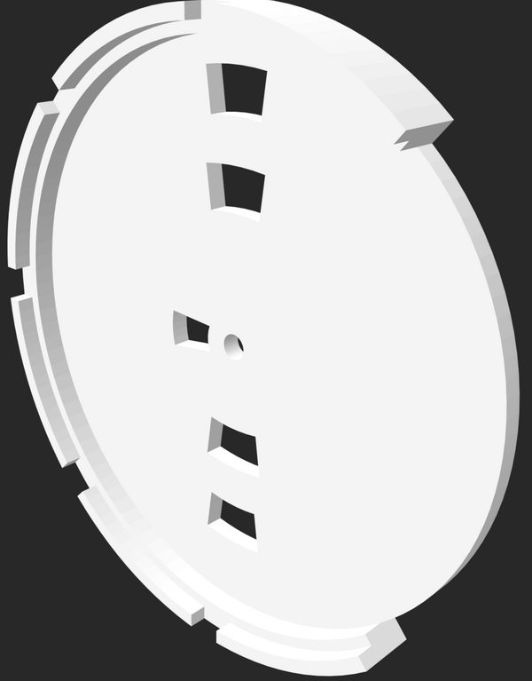
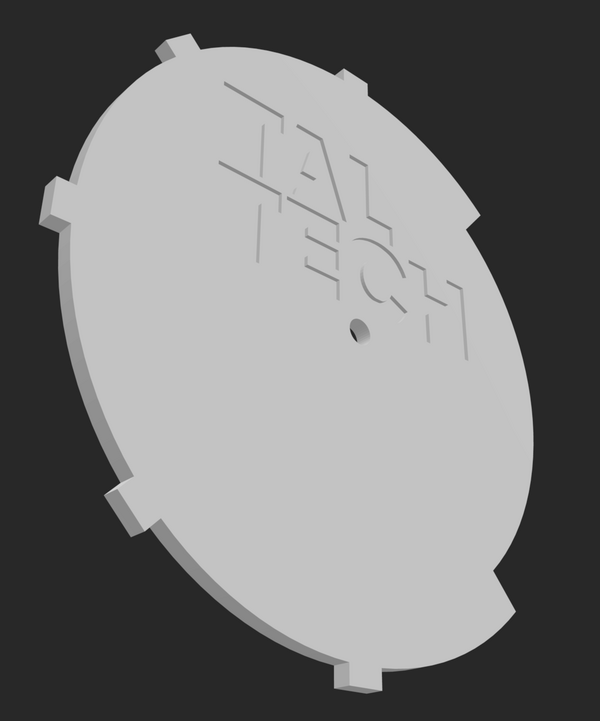
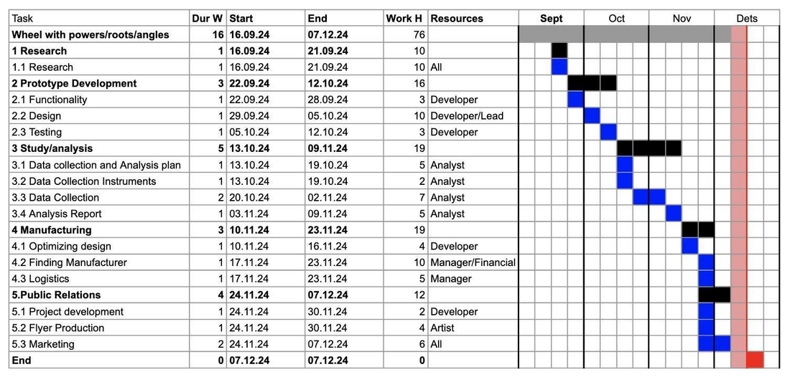

# Trigonometric Wheel: rapid-prototyping product project

**Course:** EMT0230 Rapid Prototyping (TalTech, autumn 2024, my first semester) · **Team H:** Artur Alen (project lead), Alejandro García Álvarez (project manager), Maksim Sauliak (developer), Arthur Andreas Aavik (market analyst), **Jordan Brodie (financial advisor)** · **Tools:** SolidWorks, 3D printing (PLA), Excel

A TalTech souvenir that is also a study tool: two interlocking 3D-printed discs that rotate to show sine, cosine, tangent and cotangent values for common angles. We took it from an idea poll through requirements, CAD, cost analysis, a business model and a life-cycle assessment.

| Concept sketch | CAD: front wall | CAD: back wall (TalTech logo) |
|---|---|---|
|  |  |  |

## What the team did

- **Requirements:** trigonometric values for 0°, 30°, 45°, 60°, 90°, 180° and 270°; affordable; branded; ready for production by 21 December 2024.
- **CAD:** two snap-together walls modelled in SolidWorks and exported for printing ([`cad/`](cad/), which GitHub shows in 3D). The value table for the wheel face is in [Wheel_Face_Drawing.pdf](Wheel_Face_Drawing.pdf).
- **Electronics study:** we compared adding an LCD with a microcontroller, voice input, or LEDs against the effect on price, and tested an Arduino + LCD set-up before deciding the souvenir should stay purely mechanical.
- **Project management:** work breakdown structure, responsibility matrix and Gantt chart.
- **Business:** business model canvas, production-cost model and financial plan, plus a life-cycle assessment of PLA printing.

## My part

As **financial advisor** I built the budget and the cost analysis for batch production, and checked the project stayed within budget. The team shared design and prototyping work across roles.

Full report: [Trigonometric_Wheel_Report.pdf](Trigonometric_Wheel_Report.pdf)
