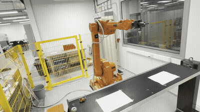
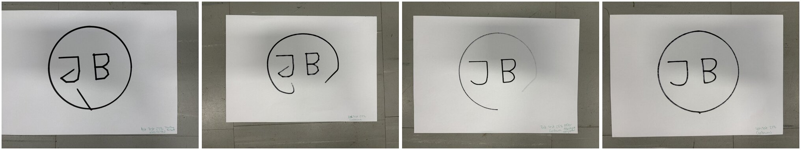
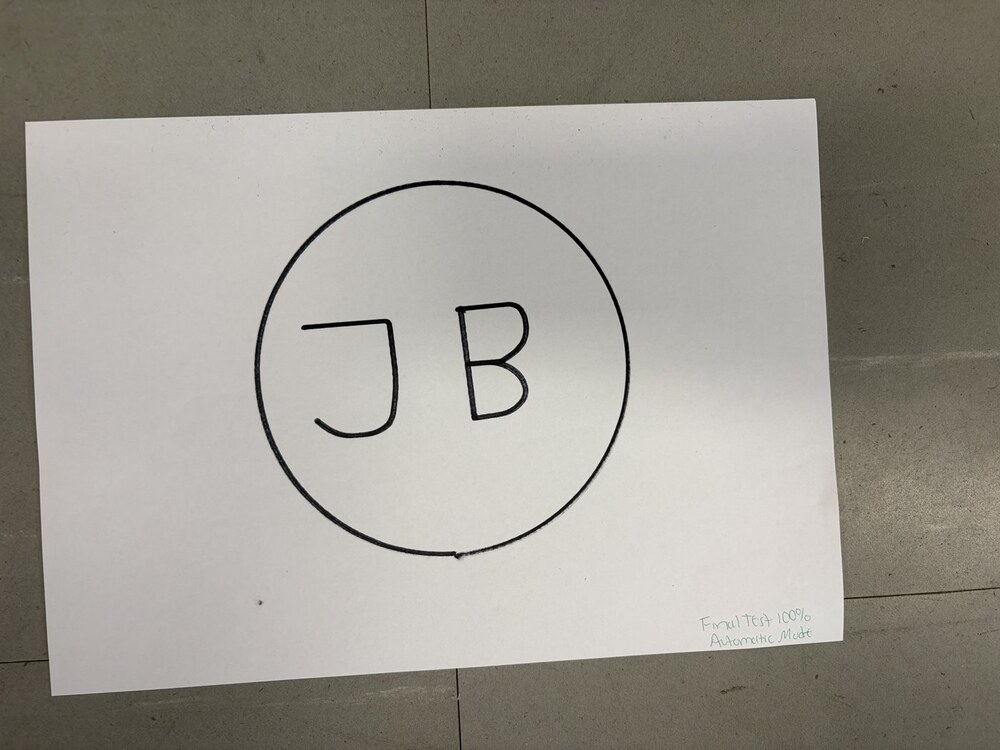

# ABB IRB 1600: drawing a circle and the initials "JB" (RAPID), simulation to real robot

**Course:** ATR0030 Robotics, Lab 2 and Lab 3 (TalTech, October 2026) · **Tools:** ABB RobotStudio, RAPID

I built a virtual robot station in ABB RobotStudio with an IRB 1600-6/1.45 arm holding a marker and programmed it to draw a 140 mm circle and the letters **J** and **B** (Lab 2). Then I ran the program on the **real IRB 1600**, found what went wrong on paper, fixed the code over five test runs and finished at **100 % speed in automatic mode** (Lab 3).



## What the program does

[`JB_drawing.mod`](JB_drawing.mod) (simulation version) has four procedures:

| Procedure | Draws | How the targets were made |
|---|---|---|
| `Path_10` | Circle, radius 70 mm | **AutoPath** around a cylinder: two `MoveC` circular moves through four points |
| `Path_20` | Letter J | **Free targets** placed by hand, joined with `MoveJ` |
| `Path_30` | Letter B | Free targets, including both bowls and the middle bar |
| `main` | Runs all three, then returns every joint to 0 with `MoveAbsJ` | — |

Engineering details I had to get right:

- **Pen up / pen down.** Each letter starts at a target 10 mm above the paper (`…up`) and then lowers the pen.
- **Tool orientation.** All targets share the quaternion `[0, 0.707, 0.707, 0]` so the marker points straight down, and the same arm configuration `[-1,-1,0,1]` so the robot never flips its wrist mid-letter.
- **Work object.** All targets are defined in a `Paper1` work object, so moving the paper only means re-teaching one frame, not every point.

```rapid
PROC main()
    Path_10;   ! draw the circle
    Path_20;   ! draw the letter J
    Path_30;   ! draw the letter B
    MoveAbsJ calib_pos, v1000, z0, tool0;   ! return to calibration position
    Stop;
ENDPROC
```

## From simulation to the real robot (Lab 3)

The simulation looked right, but the real drawing showed four problems. I fixed each one in [`JB_drawing_real_robot.mod`](JB_drawing_real_robot.mod) (every change is marked `! CORRECTED` or `! NEW`):

| Problem on paper | Cause | Fix |
|---|---|---|
| A skid line from the end of the circle to the J, and from the J to the B | The pen was only lifted at the *start* of each letter | New `Target_50up` / `Target_90up`: lift 10 mm at the *end* of each shape too |
| The circle didn't close; its start and end were cut | Zone `z100` lets the robot pass up to 100 mm from a target | Zone `fine` on the circle, so it stops exactly on each point |
| Letter strokes were bent | `MoveJ` interpolates joints, so the pen path between targets isn't straight | `MoveL` for every drawing stroke |
| Curves of J and B were sharp polygons | Zone `z0` stops at every point | Zone `z50` on the curved parts so corners blend into curves |

| Test runs 1–4 (25 % speed, step-by-step → continuous → corrected → final) | Final result at 100 % speed, automatic mode |
|---|---|
|  |  |

`calib_pos`, the `markerB` tool and the `Paper1` work object are defined in the robot station's own data module, so they aren't repeated in these files.

## Simulation results (Lab 2)

| Paths in the RobotStudio station | Close-up of the planned paths |
|---|---|
|  |  |

| Simulation frames | Development process |
|---|---|
|  |  |

Reports: [Lab 2 – simulation](../../docs/coursework-reports/ATR0030_Lab2_ABB_RobotStudio.pdf) · [Lab 3 – real robot](../../docs/coursework-reports/ATR0030_Lab3_ABB_IRB1600_Real_Robot.pdf)
