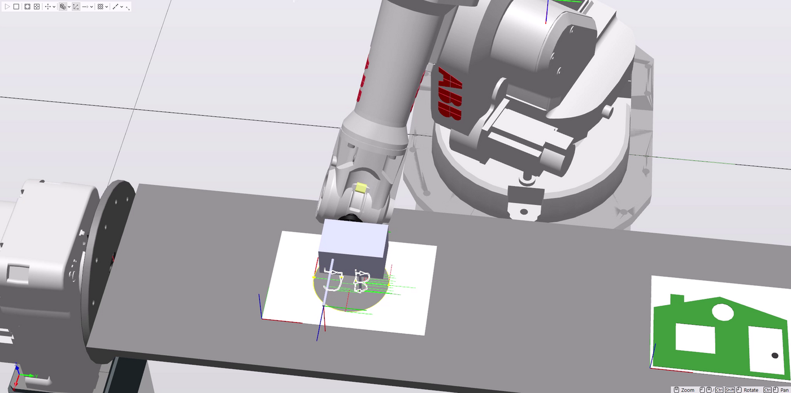
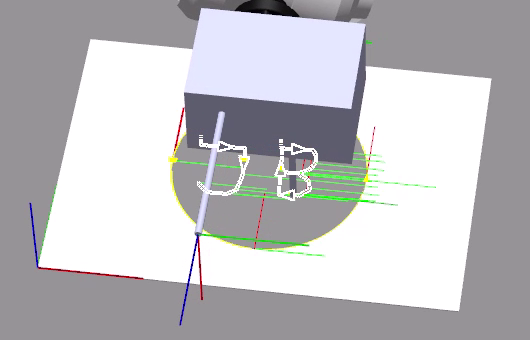
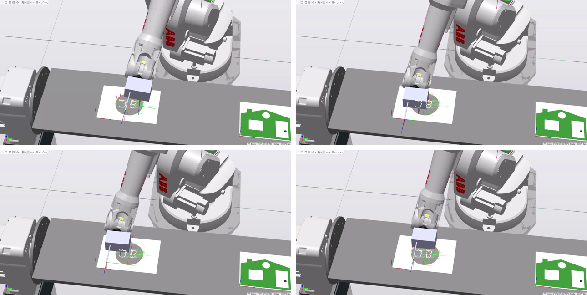
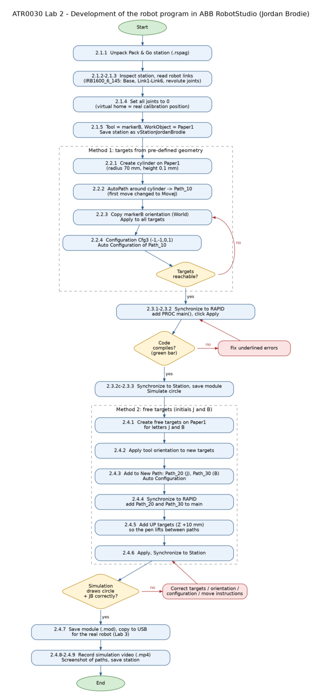

# ABB IRB 1600: drawing a circle and the initials "JB" (RAPID)

**Course:** ATR0030 Robotics, Lab 2 and Lab 3 (TalTech, October 2026) · **Tools:** ABB RobotStudio, RAPID

I built a virtual robot station in ABB RobotStudio with an IRB 1600-6/1.45 arm holding a marker, programmed it to draw a 140 mm circle and the letters **J** and **B**, and prepared the program to run on the real robot in the next lab.

## What the program does

[`JB_drawing.mod`](JB_drawing.mod) has four procedures:

| Procedure | Draws | How the targets were made |
|---|---|---|
| `Path_10` | Circle, radius 70 mm | **AutoPath** around a cylinder: two `MoveC` circular moves through four points |
| `Path_20` | Letter J | **Free targets** placed by hand, joined with `MoveJ` |
| `Path_30` | Letter B | Free targets, including both bowls and the middle bar |
| `main` | Runs all three, then returns every joint to 0 with `MoveAbsJ` | — |

Engineering details I had to get right:

- **Pen up / pen down.** Every letter starts at a target 10 mm above the paper (`…up`) so the marker doesn't drag a line between letters.
- **Tool orientation.** All targets share the quaternion `[0, 0.707, 0.707, 0]` so the marker points straight down, and the same arm configuration `[-1,-1,0,1]` so the robot never flips its wrist mid-letter.
- **Work object.** All targets are defined in a `Paper1` work object, so moving the paper only means re-teaching one frame, not every point.

```rapid
PROC main()
    Path_10;   ! draw the circle
    Path_20;   ! draw the letter J
    Path_30;   ! draw the letter B
    MoveAbsJ calib_pos, v1000, z0, tool0;   ! return to calibration position
    Stop;
ENDPROC
```

## Results

| Paths in the RobotStudio station | Close-up of the planned paths |
|---|---|
|  |  |

| Simulation frames | Development process |
|---|---|
|  |  |

Full report: [ATR0030_Lab2_ABB_RobotStudio.pdf](../../docs/coursework-reports/ATR0030_Lab2_ABB_RobotStudio.pdf)
