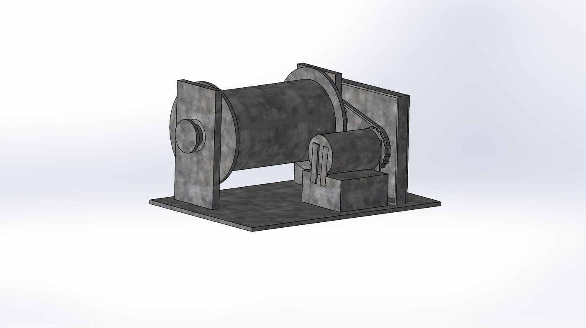
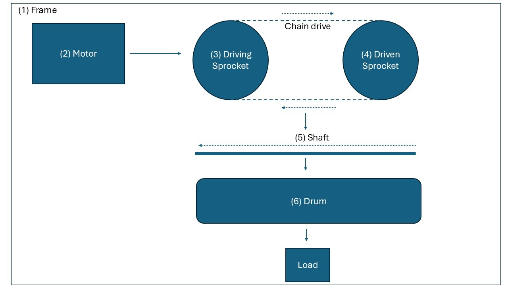
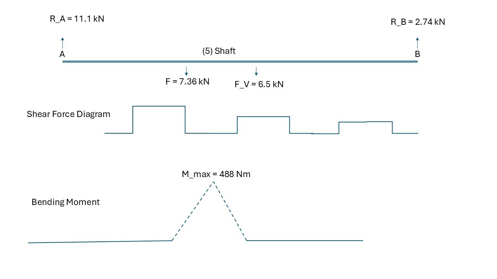
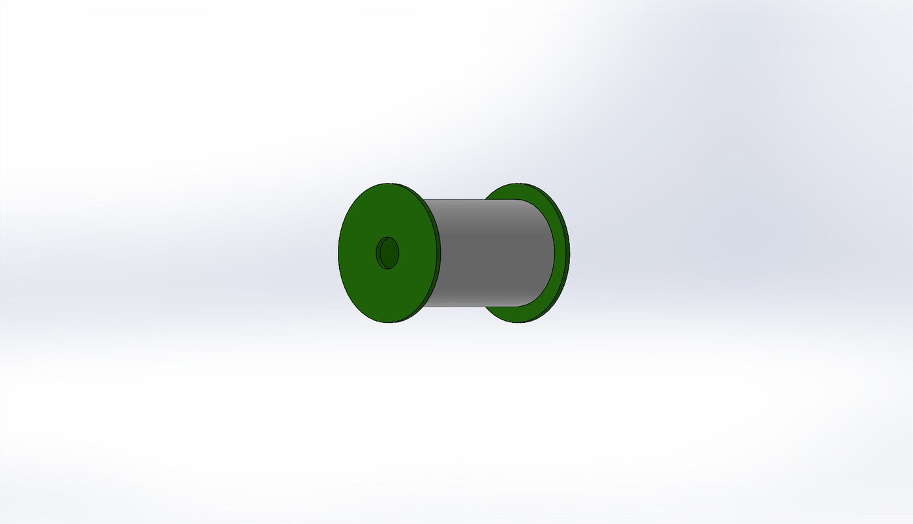
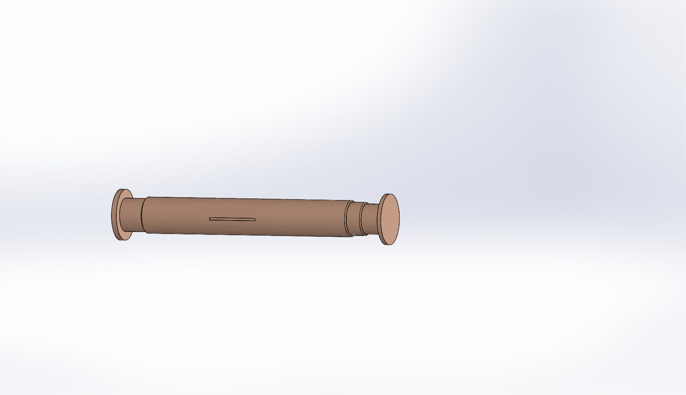
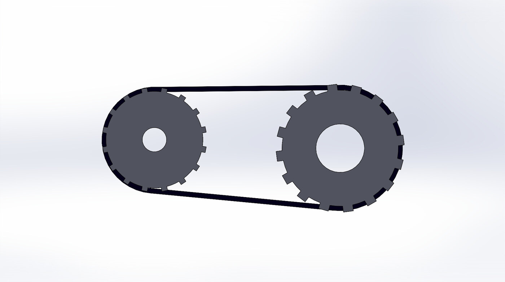
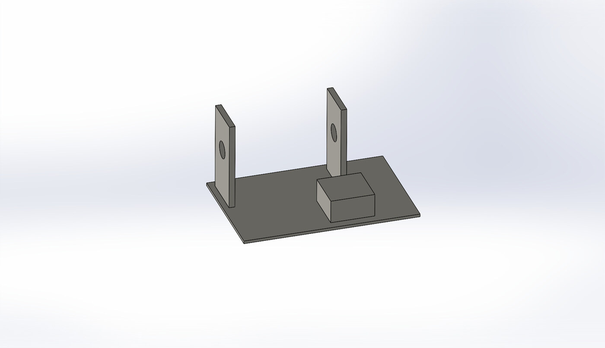

# Electric winch: 750 kg workshop hoist (design, calculations, CAD)

**Course:** MES0225 Machine Engineering – Project (TalTech, spring 2026) · **Individual project** · **Tools:** SolidWorks (parts, assembly, drawings), hand calculations, Python

I designed an electric winch for lifting heavy components in an assembly workshop. I started from the requirements, selected the components and checked them for strength, then modelled every part in SolidWorks and produced the assembly drawing.

| Requirement | Value |
|---|---|
| Rated load | 750 kg |
| Rope speed | 0.11 m/s |
| Drive | Gear motor → chain drive → drum |
| Design goal | Minimum size and mass |



## Design decisions

| Component | Selection | Why |
|---|---|---|
| Rope | TEK 13310, Ø10 mm, breaking force 59.7 kN | Safety factor 5.5 for lifting; margin for multi-layer winding |
| Drum | Ø200 mm × 400 mm, welded S235, 7 mm wall | D = 20·d for moderate duty; 40 turns per layer (~25 m of rope) |
| Gear motor | SEW-Eurodrive R77 DT90S4, 1.1 kW, 17 rpm | Covers 0.95 kW needed after gear, chain and bearing losses |
| Chain drive | 16B-2 double-strand, 19 / 31 teeth, ratio 1.6 | Double strand with a smaller pitch instead of a bulky 20B single strand, to keep the winch compact |
| Shaft | C45E, Ø50 / 55 / 60 mm | Sized for torsion, then checked for combined stress and fatigue at the bearing shoulder |
| Bearings | SKF SY 55 TF self-aligning plummer blocks | Calculated life ≈ 96 000 h, far above the 14 000 h needed |
| Keys | 14 × 9 mm, two per joint | One key failed the contact-stress check at the sprocket (172 MPa > 130 MPa), so I used two keys 180° apart |

| Kinematic diagram | Shaft forces and bending moments |
|---|---|
|  |  |

## CAD

All parts were modelled in SolidWorks and assembled; the assembly drawing has a bill of materials.

| Drum | Shaft | Chain drive | Frame |
|---|---|---|---|
|  |  |  |  |

- [Assembly drawing (PDF, A3)](Electric_Winch_Assembly_Drawing.pdf)
- [Full design report (PDF, 20 pages)](Electric_Winch_Design_Report.pdf)

## Design calculator (Python)

[`calculations/winch_design.py`](calculations/winch_design.py) turns the report's hand calculations into code, so the design can be re-checked when a requirement changes. It runs every strength check from the report and prints PASS / FAIL. The tests confirm it reproduces the report's numbers.

```bash
cd calculations
python winch_design.py              # the 750 kg design
python winch_design.py --load 1000  # what breaks at 1000 kg?
pytest -q                           # 18 tests: results match the report
```

Results for the 750 kg design:

| Check | Value | Limit | Result |
|---|---:|---:|:---:|
| Rope: load vs allowable | 7,357.5 N | ≤ 10,854.5 N | ✅ |
| Motor: power delivered to drum | 941.8 W | ≥ 809.3 W | ✅ |
| Motor: rope speed error | 1.1 % | ≤ 3.0 % | ✅ |
| Chain: roller pressure | 24.7 MPa | ≤ 40.0 MPa | ✅ |
| Chain: safety factor | 15.8 - | ≥ 7.3 - | ✅ |
| Shaft: chosen diameter vs torsion minimum | 50.0 mm | ≥ 49.5 mm | ✅ |
| Shaft: equivalent stress at bearing A | 49.6 MPa | ≤ 246.7 MPa | ✅ |
| Shaft: fatigue safety factor | 3.2 - | ≥ 2.5 - | ✅ |
| Bearing A: L10 life | 90,814.7 h | ≥ 14,000.0 h | ✅ |
| Key (drum hub): contact stress | 53.1 MPa | ≤ 130.0 MPa | ✅ |
| Key (drum hub): shear stress | 13.3 MPa | ≤ 70.0 MPa | ✅ |
| Key (sprocket): contact stress | 85.8 MPa | ≤ 130.0 MPa | ✅ |
| Key (sprocket): shear stress | 21.5 MPa | ≤ 70.0 MPa | ✅ |
| Drum: equivalent stress | 108.3 MPa | ≤ 120.0 MPa | ✅ |

At **1000 kg** the calculator shows four failures: the motor is too small, the shaft is under-sized for torsion, the fatigue safety factor drops to 2.4, and drum stress reaches 144 MPa (> 120 MPa). So the motor, shaft and drum wall would all need to be redesigned.

Notes from writing the calculator:
- The report rounds the chain speed to 0.14 m/s. Using the exact 0.137 m/s raises the shaft loads by about 2 %, which changes nothing in the conclusions.
- Writing the calculator caught three inconsistencies, now fixed in the PDFs here: the bearing-span formula in the shaft-layout table (now L_tr + 2·L_b = 520 mm), and the drawing's bill of materials, which listed an older motor, chain and key (now SEW R77 DT90S4, 16B-2 sprockets N16B2-19 / N16B2-31, key 14×9×80 DIN 6885, matching the calculations).

*The calculator was written in 2026 with AI assistance, from my own report.*
