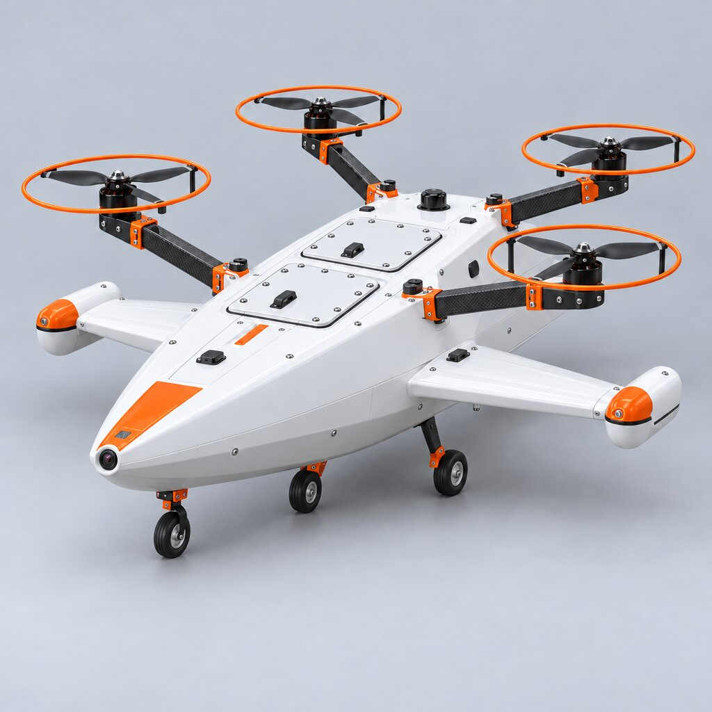
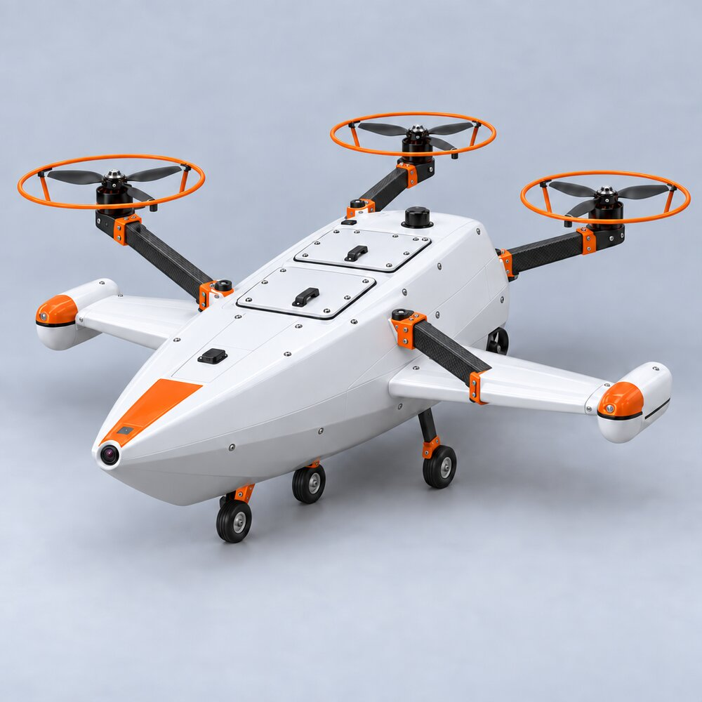

# AquaFlyer ("Icarus"): an amphibious fly / float / drive drone

**My own project, started October 2026.** This page is the working plan and log. I update it as the project moves from concept to CAD to a flying prototype.

| 3-wheel layout with dual hatches | Flying-boat hull | Symmetric quad |
|---|---|---|
|  |  |  |

*Concept renders generated with Meshy AI to explore shapes quickly. They are not CAD; the CAD is the next step (Fusion 360).*

## 1. Mission

A small vehicle that can **fly** to a site, **land on water and float**, and **drive** on land, so one platform can inspect a shoreline, a pond or a harbour without being carried between them. It also gives me a hands-on way to work through the whole systems-engineering life cycle on something I build myself.

## 2. Draft requirements (v0.1, to be refined with mass and power estimates)

| ID | Requirement | How I'll verify it |
|---|---|---|
| R1 | Take off, hover and land under manual and assisted control | Flight test |
| R2 | Float upright and stay stable on calm water with the motors off | Tank test |
| R3 | Take off from the water surface | Tank / pond test |
| R4 | Drive on flat ground under its own power | Ground test |
| R5 | Keep electronics dry during water operation (sealed hatches) | Splash and float test, inspection |
| R6 | Main structure printable on a consumer FDM printer | Inspection (print it) |
| R7 | Carry a camera for inspection, with an onboard computer for vision | Integration test |
| R8 | Fail safe: return or land when the radio link or battery is lost | Bench test, then flight test |

## 3. Concept trade-off (first pass)

| Concept | Strengths | Risks |
|---|---|---|
| **3-wheel with dual hatches** | Simple ground mobility; hatches give access to sealed electronics | Wheels add mass and drag in flight and on water |
| **Flying-boat hull** | Best water stability and take-off from water | Hull shape is harder to print; more weight |
| **Symmetric quad** | Simplest flight dynamics; easiest to tune | Needs added floats; weakest on land |

Next: estimate mass, thrust-to-weight ratio and buoyancy for each concept, then score them against R1–R8 and pick one to model in CAD.

## 4. Candidate architecture (from the parts inventory I am working with)

| Function | Candidate hardware |
|---|---|
| Flight controller & navigation | Holybro Pixhawk 6C Mini + M10 GPS (PX4 / ArduPilot) |
| Companion computer & vision | Raspberry Pi Zero 2 W + Pi Camera 3 NoIR |
| Propulsion | Brushless motors with ESCs; 7–10" propellers depending on mass |
| Power | 4S 4000 mAh LiPo, XT60, 5 V UBEC for the electronics |
| Actuation | Servos for steering and hatch locks |
| Radio & video | ELRS receiver, 5.8 GHz video transmitter, FPV camera |

## 5. Plan and progress log

| When | Step | Status |
|---|---|---|
| Oct 2026 | Mission, concept renders, draft requirements, hardware inventory | ✅ Done |
| Nov 2026 | Mass / thrust / buoyancy estimates, then pick a concept | ⏳ Next |
| Dec 2026 | CAD in Fusion 360; print the hull and arms | Planned |
| Spring 2027 | Bench tests (motors, ESCs, failsafe), then float test | Planned |
| Summer 2027 | First hover, then water take-off | Planned |

Photos, CAD and test results will be added here as each step is done.
