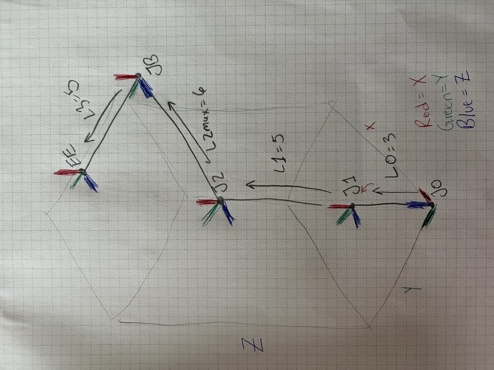
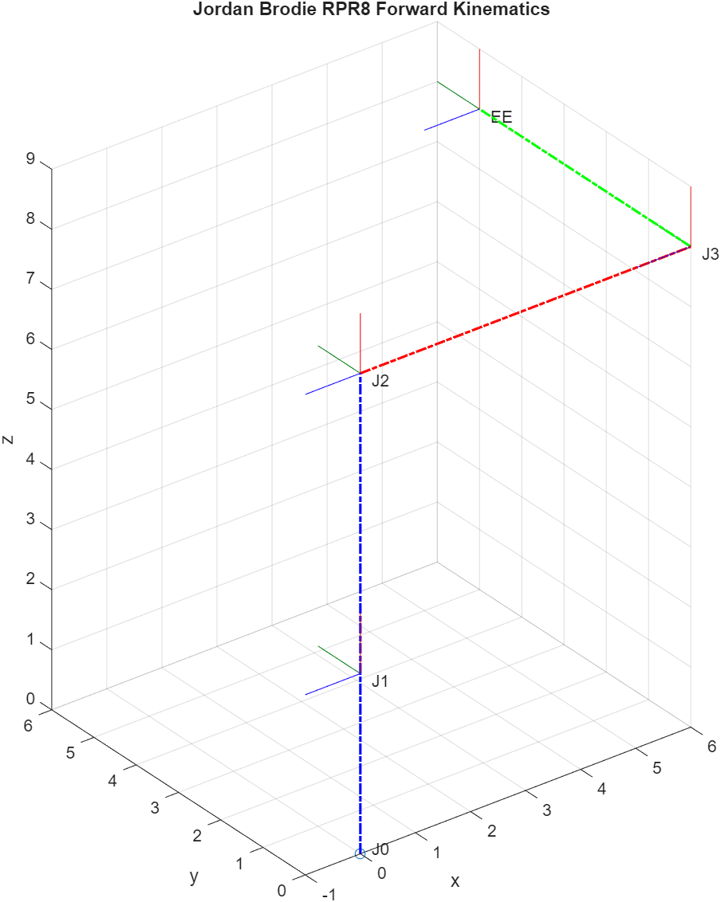
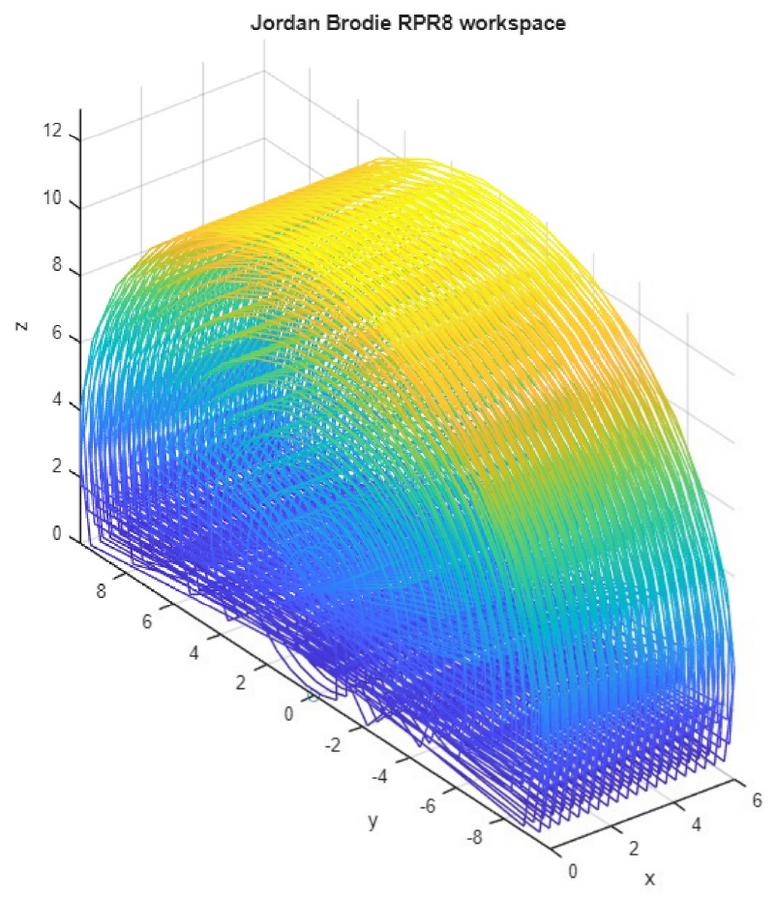
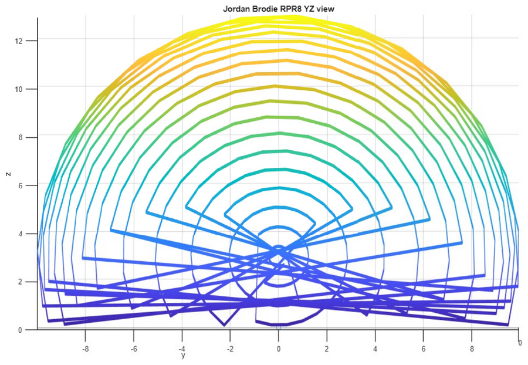
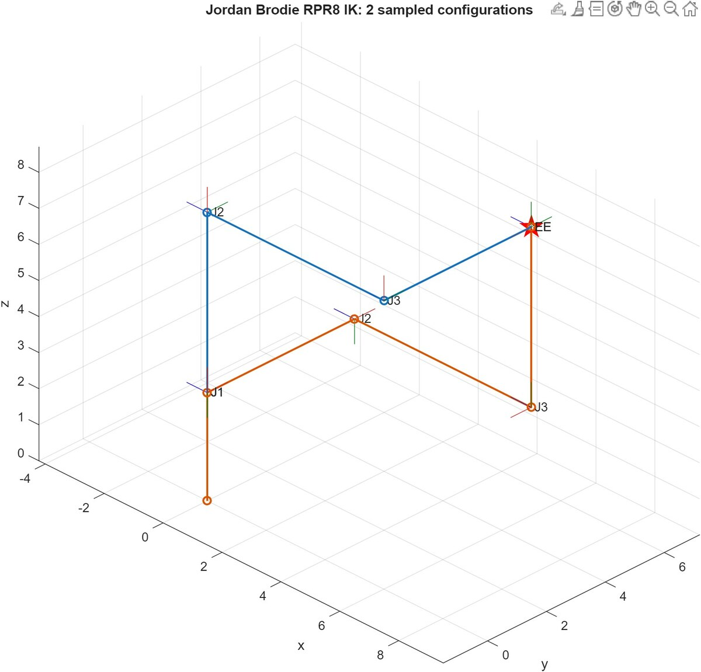
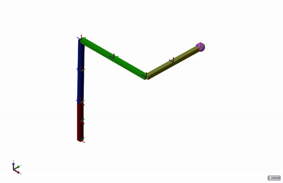
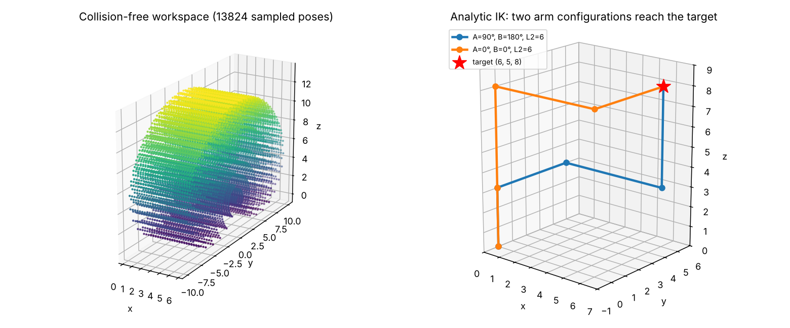

# RPR manipulator: forward kinematics, workspace, inverse kinematics, 3D simulation

**Course:** ATR0030 Robotics (TalTech, autumn 2026) · **Individual variant:** RPR8 · **Tools:** MATLAB (Robotics System Toolbox), Simulink / Simscape Multibody, Python (NumPy, Matplotlib, pytest)

A 3-degree-of-freedom arm with a **R**evolute joint *A*, a **P**rismatic joint *L2* (0–6) and a second **R**evolute joint *B*. Link lengths: L0 = 3, L1 = 5, L2max = 6, L3 = 5. I modelled it step by step across four lab exercises, each building on the last.

| Step | What I did | MATLAB | Report |
|---|---|---|---|
| 1. Forward kinematics | Sketched the frames by hand, built the chain of homogeneous transforms and plotted joints and frames at home position (EE = [6 5 8]). | [`RPR8_forward_kinematics.m`](matlab/RPR8_forward_kinematics.m) | [PDF](reports/1_Forward_Kinematics.pdf) |
| 2. Workspace | Swept A, B and L2, rejected any pose where the end effector or J3 hits the floor, and plotted the collision-free workspace. Joint A is limited to ±1.148 rad so B can still rotate a full turn. | [`RPR8_workspace.m`](matlab/RPR8_workspace.m) | [PDF](reports/2_Workspace.pdf) |
| 3. Inverse kinematics | Generate-and-test search over 108 864 configurations to find every joint setting that reaches a target. Transforms are cached outside the inner loop to keep it fast. | [`RPR8_inverse_kinematics.m`](matlab/RPR8_inverse_kinematics.m) | [PDF](reports/3_Inverse_Kinematics.pdf) |
| 4. 3D simulation | Physical model in Simscape Multibody with bodies, joints and motion inputs; EE position measured and compared with the FK model. | [`RPR8_simscape.slx`](matlab/RPR8_simscape.slx) | [PDF](reports/4_Simscape_Simulation.pdf) |

| Hand sketch of the frames | MATLAB FK plot at home position |
|---|---|
|  |  |

| MATLAB workspace (3D) | MATLAB workspace (YZ view) |
|---|---|
|  |  |

| MATLAB IK: configurations found | Simscape simulation |
|---|---|
|  |  |

## Going further: Python port and a closed-form IK

The coursework solved IK by brute force. Afterwards the model was ported to Python ([`python/rpr8.py`](python/rpr8.py)) and the transform chain was multiplied out to get the end-effector position in closed form:

```
x = L2
y = L1·sin A + L3·cos(A + B)
z = L0 + L1·cos A − L3·sin(A + B)
```

This shows that the prismatic joint sets *x* on its own, and in the *y–z* plane the arm behaves as a **two-link planar arm** (links L1 and L3, elbow angle B + 90°). So IK has an exact solution instead of a search:

```
cos q = (r² − L1² − L3²) / (2·L1·L3),   r² = y² + (z − L0)²
A = atan2(y, z − L0) − atan2(L3·sin q, L1 + L3·cos q),   B = q − 90°,   L2 = x
```

For the target (6, 5, 8) the analytic solver returns the same two configurations that the MATLAB search found, **(A, B, L2) = (0°, 0°, 6) and (90°, 180°, 6)**, instantly and without a tolerance.



```bash
cd python
pip install numpy matplotlib pytest
python rpr8.py      # FK at home, brute-force IK and analytic IK
python plots.py     # regenerate the figure above
pytest -q           # 56 tests
```

The tests check that:
- the Python FK matches the MATLAB home position;
- the closed-form equations match the full matrix chain for 200 random poses;
- the brute-force search reproduces the MATLAB result exactly;
- the analytic IK round-trips 50 random reachable targets and rejects unreachable ones.

*The MATLAB code and reports are my coursework. The Python port and the closed-form IK were written in 2026 with AI assistance, starting from my MATLAB transform chain; the tests verify them against my MATLAB results.*
