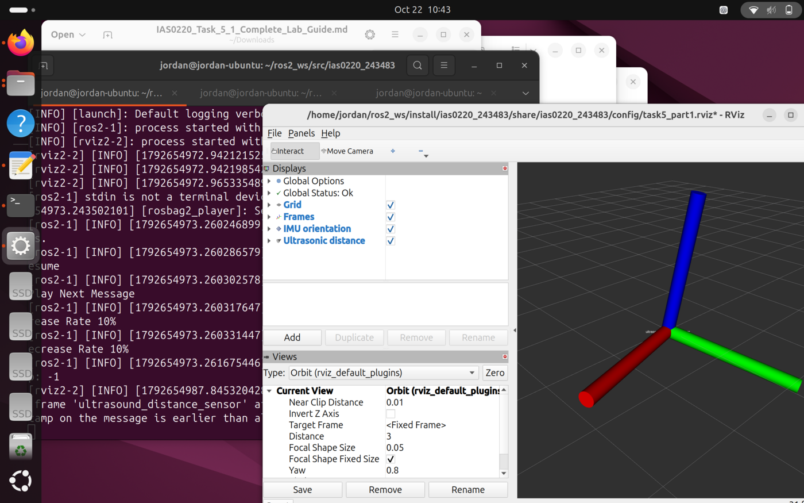
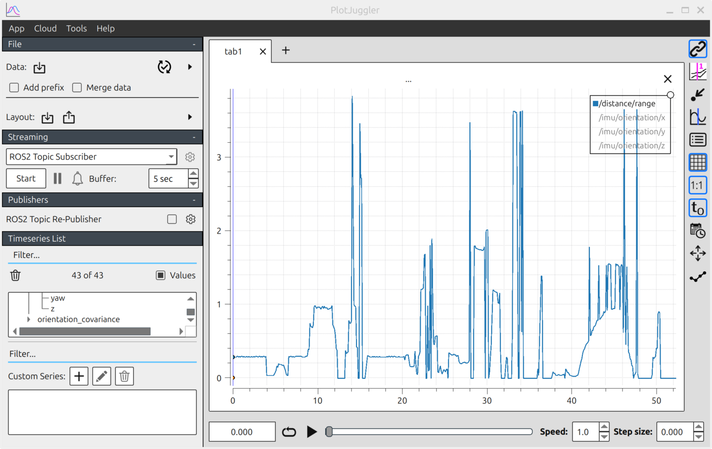
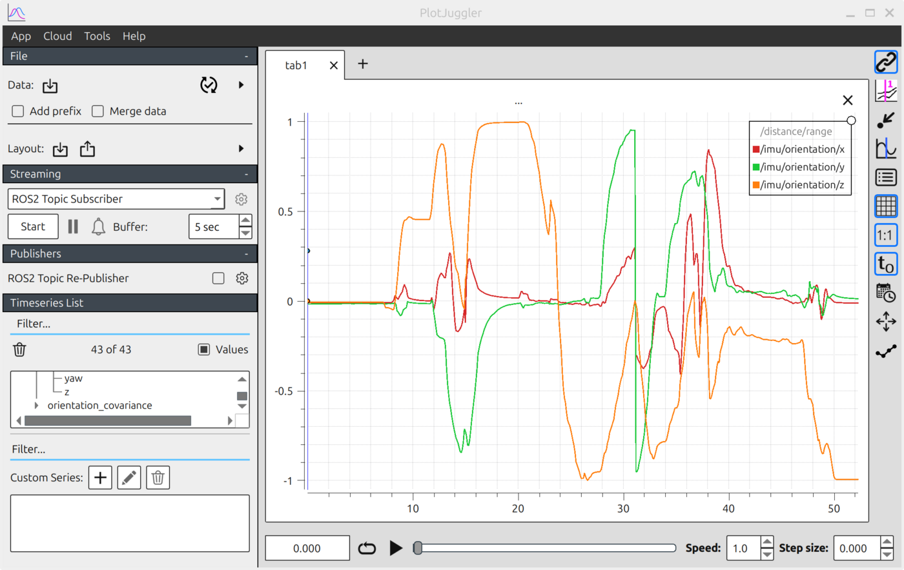
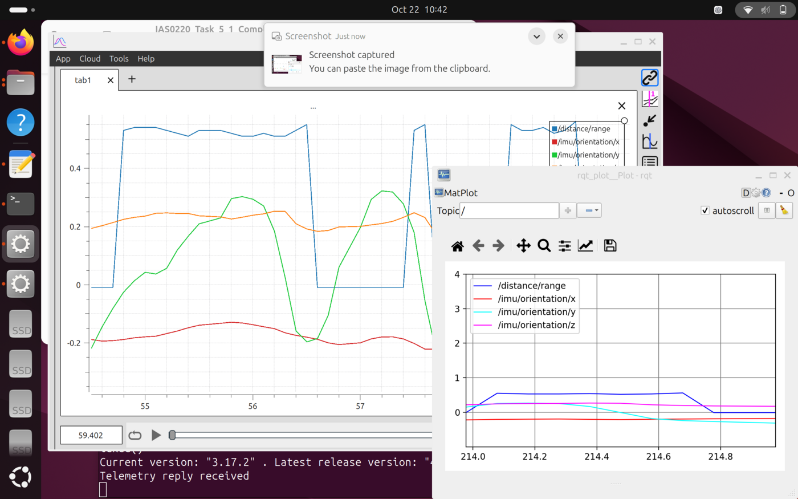

# ROS 2 — Robot Programming (IAS0220, TalTech, autumn 2026)

Weekly coursework for **IAS0220 Robot Programming**. The live code lives in its own repository and is updated every week:

**➡ [github.com/jordantbrodie/ias0220](https://github.com/jordantbrodie/ias0220)**

This page summarises what is there and shows results.

## What I built so far

| Week / task | What it does | Key files |
|---|---|---|
| Task 2: publish / subscribe | Two nodes: a `/walker` publisher and a `/position_calculator` subscriber exchanging messages over topics. | `ias0220_243483/` |
| Task 3: robot model | A differential-drive robot described in MuJoCo XML (body, wheels, joints, actuators) and simulated. | `mujoco/my_robot.xml` |
| Task 4.2: wheel odometry | An odometry node that turns raw encoder ticks into a pose and velocity estimate (`nav_msgs/Odometry` on `/my_odom`) at 20 Hz, visualised in RViz. | `ias0220_243483/odometry.py`, `launch/differential_robot_simu_task4_part2.launch.py` |
| Task 5.1: bag files | Recording a run to a ROS 2 bag, replaying it offline and plotting distance and heading in PlotJuggler / rqt_plot. | `launch/bagfile_*`, `bags/` |

## Highlight: wheel odometry from encoder ticks

The node handles the details that make odometry go wrong on real robots:

- **Encoder wrap-around.** The simulated encoders wrap at 508 counts, so a jump from 507 → 2 is really +3 counts, not −505. `count_difference()` corrects for this.
- **Mirrored wheels.** The right encoder counts in the opposite direction, so its distance is negated.
- **Midpoint integration.** Position is integrated using the heading halfway through each step, which is more accurate than using the old or new heading.
- **Quaternions throughout.** Orientation is updated by quaternion multiplication, not by adding angles.

```python
d_center = (d_left + d_right) / 2.0
d_theta  = (d_right - d_left) / WHEEL_SEPARATION
self.q   = qmult(self.q, euler2quat(0.0, 0.0, d_theta))
mid_yaw  = quat2euler(self.q)[2] - d_theta / 2.0
self.x  += d_center * math.cos(mid_yaw)
self.y  += d_center * math.sin(mid_yaw)
```

## Results

| RViz: odometry estimate while driving | Recorded run: distance travelled |
|---|---|
|  |  |

| Recorded run: heading | Live plots (rqt_plot and PlotJuggler) |
|---|---|
|  |  |

## Tools

ROS 2 (rclpy, launch files, topics, bags), MuJoCo, RViz, PlotJuggler, rqt_plot, transforms3d.
